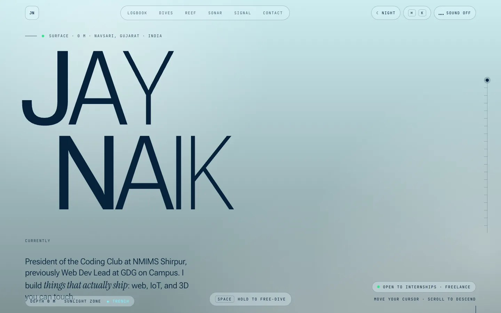
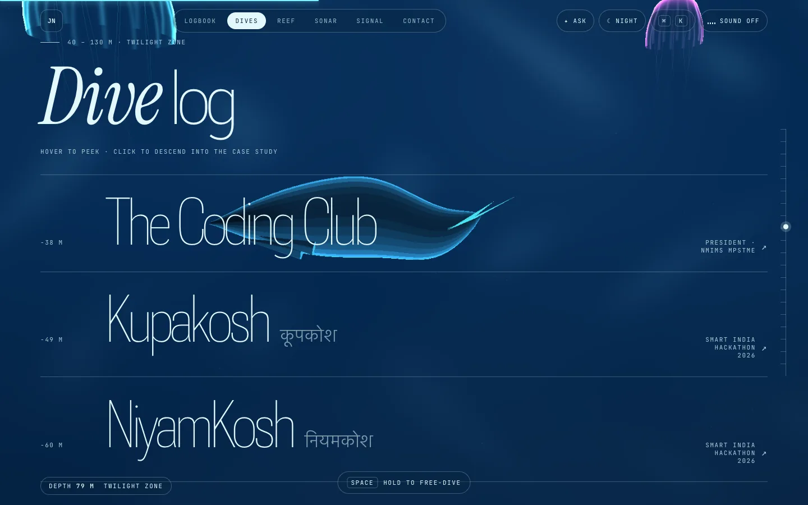
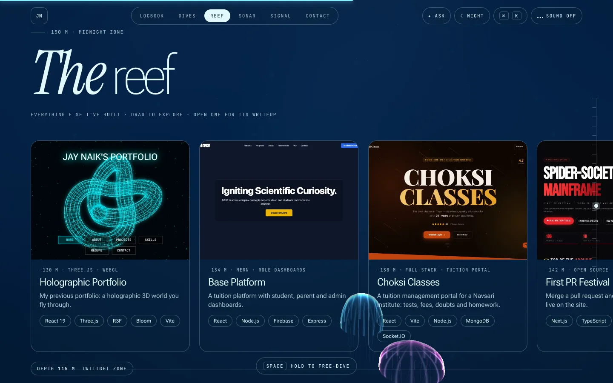
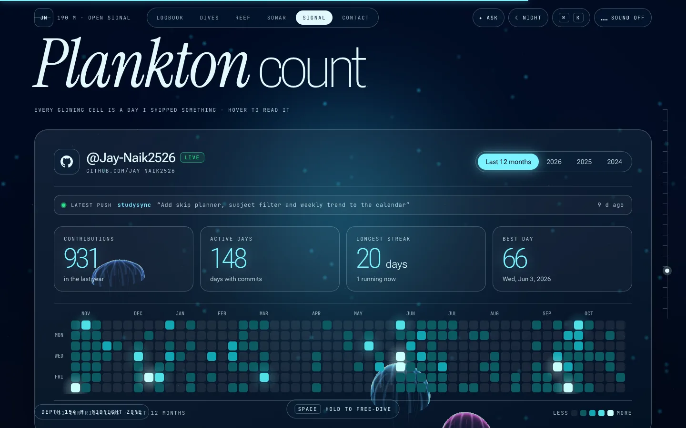
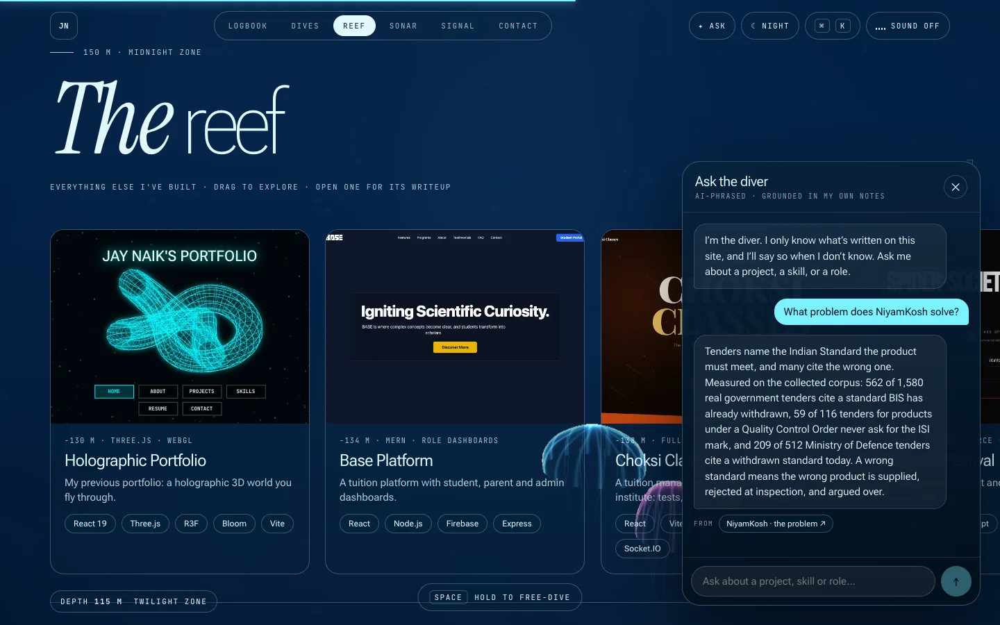

<div align="center">

# 🌊 DEEP DIVE

### A portfolio you don't scroll. You descend.

The page is a body of water. The deeper you go, the darker and stranger it gets.<br>
Projects live at different depths. Skills sit on a sonar. GitHub activity glows as plankton.<br>
There's a diver you can interrogate, and a secret at the very bottom.

**[▶ Dive in: jaynaik.antideploy.app](https://jaynaik.antideploy.app)**




</div>

---

## What's down there

<table>
<tr>
<td width="50%"></td>
<td width="50%"></td>
</tr>
<tr>
<td><b>Dive log.</b> The big projects as giant variable-font type. Hover to peek, click to descend into a full case study.</td>
<td><b>The reef.</b> Everything else I've built, on a draggable strip. Every card opens its own writeup.</td>
</tr>
<tr>
<td width="50%"></td>
<td width="50%"></td>
</tr>
<tr>
<td><b>Plankton count.</b> A live GitHub contribution graph with the latest push, streaks and a best day.</td>
<td><b>Ask the diver.</b> A chat that can only answer from what's written on this site, and cites where.</td>
</tr>
</table>

## The tricks

### 🌊 The water is a shader
One full-screen GLSL pass: caustics, ripples that follow your cursor (analytic gradient, single pass), god rays, bioluminescence and a night palette. Depth (0 → 1) drives the colour of the water, the ink colour of the text, the jellyfish and the zone you're in. Jellyfish and whales are real geometry in the same scene.

### 🔤 Letters that bend under your cursor
Headlines are variable-font text (Roboto Flex, `wght` / `wdth` / `opsz`) that morph as the pointer passes over them.

### 🤿 Free-dive
Hold `Space` and you fall. `⌘K` opens a command palette that jumps anywhere. There's a night mode, procedural ambient sound built with the Web Audio API (no audio files at all), and a trench at the bottom with something hidden in it.

### 🧠 Ask the diver
A chat grounded **only** in the site's own writing.

1. Questions are matched against every project writeup, role and skill with BM25 keyword ranking plus hand-written intents.
2. The best passages go to a small serverless function holding the Groq key. A model (`gpt-oss-120b`) phrases the answer from **those passages only**, returns which ones it used, and says "not in my notes" otherwise. The source chips show only passages that were actually sent.
3. If the function is down, slow or refuses, the offline engine answers instead, quoting my own sentences verbatim. No question ever dead-ends on an error.

The key never reaches the browser. The function allows only the site's origins, caps input size and rate-limits per visitor. Visitor questions are never logged by the site, and analytics only counts *that* a question was asked.

### 🪼 Plankton count (the contribution graph)
Drawn on a single `<canvas>` instead of hundreds of animated DOM cells (that one change removed a 1-second stall). Data comes live from a public contributions API, merged day by day with a bundled snapshot so private activity is kept, then refreshed every 10 minutes and on tab focus. A daily GitHub Action refreshes the snapshot so the numbers stay honest even if the API is down.

### 📓 Real writeups for all 23 projects
Every project, featured or not, has the same case-study window: the problem, what was built, numbers, and (where it matters) what it honestly does **not** claim. A test fails the build if any project is missing one. The "why I built it" slot is left blank on purpose until I write it myself.

### 🎓 Credentials wall
Certificates hang as framed prints on a gallery wall with glass plaques, an issuer ribbon and a viewer. Every Coursera certificate carries its verification link and certificate ID, taken from the PDF itself. A test fails the build if a certificate's image is missing or a Coursera one has no verify link.

### ⚡ Quick view
`#/quick` is a one-screen summary for a recruiter: who I am, current roles, the projects that matter, and the links. It only shows projects that exist and have something to link to, and a test enforces that.

### 📖 A guestbook with no server
Visitors sign through a GitHub Issue form. It appears on the site only after I approve it by labelling the issue. The parser is pure and strict, so it can't render anything unsafe.

### 📈 Privacy-friendly analytics
Cookie-free (GoatCounter or Plausible), off until configured, honours Do Not Track and `?notrack`, and only sends a fixed set of event names.

## Fast on a phone

Phones get a different pipeline instead of a smaller copy of the desktop one.

| | Desktop | Phone |
|---|---|---|
| Water shader | full | `LITE` variant |
| Scroll | Lenis smooth scroll | native |
| Pixel ratio | adaptive, warms up then ratchets | lower cap, 30 fps targets |
| Fallback | none needed | CSS background if WebGL is missing |

Force a tier with `?q=lite` or `?q=high`. Measured in headless Brave with a 4× CPU slowdown at 2× pixel ratio, scrolling the whole page with real wheel events: the hero and About run at about 59 fps, the dive log is the weakest section at about 53 fps, and every other section sits at 57 to 59 fps. A handful of ~67 ms frames remain in the phone-sized test. I haven't tested a real phone.

## Run it

```bash
npm install
npm run dev
```

| Command | What it does |
| --- | --- |
| `npm run build` | Type-check, refresh the contribution snapshot, build to `dist/` |
| `npm test` | Type-check and run all tests (70) |
| `npm run check:links` | Ping every external link on the site |
| `npm run sync:contrib` | Refresh the contribution snapshot (`GH_TOKEN` or the GitHub CLI) |

### Turn on the AI locally

Create `.env.local` (git ignores it):

```bash
GROQ_API_KEY=your_key_here
VITE_ASK_URL=/api/ask
```

`npm run dev` then serves a dev-only `/api/ask` that holds the key on your machine. It is never bundled. With nothing set, the site uses the hosted function, or the offline engine if you set `VITE_ASK_URL=` to an empty string.

### Deploy

The site is fully static: build and host `dist/` anywhere. The AI endpoint is a separate tiny function whose handler is [`worker/ask.mjs`](worker/ask.mjs) (a web-standard `Request` → `Response` handler, so it runs on Vercel, Cloudflare Workers or plain Node). Give it `GROQ_API_KEY` and `ALLOWED_ORIGINS` as environment variables. See [`worker/README.md`](worker/README.md).

## How it's built

```
src/
  components/   sections, the 3D scene, HUD, overlays, the diver
  diver/        corpus, BM25 search + intents, the AI client
  data.ts       projects, writeups, offers, skills, timeline: edit content here
  data/         contribution snapshot
  world.ts      shared frame state for the DOM and the WebGL scene
  quality.ts    phone / low-end detection and the quality tiers
  audio.ts      procedural sound
  github.ts     live "recently shipped" feed
  guestbook.ts  issue → safe entry parser
  analytics.ts  consent-free, opt-in analytics
worker/         the Ask-the-diver function (+ Cloudflare config)
scripts/        contribution sync, link checker
tests/          data integrity, diver, guestbook, analytics, worker
docs/           screenshots used in this README
```

**Stack:** React 19, TypeScript (strict), Vite 8, Three.js with React Three Fiber, Motion, Lenis, `@fontsource` fonts. Shared mutable frame state lives outside React, so the DOM and the WebGL scene read the same depth without re-rendering.

To add a project: edit `src/data.ts` (including its writeup) and drop a screenshot in `public/img/`. `npm test` fails if anything is missing.

## Honest notes

- The diver can still misread a passage. That's why every answer shows its sources.
- The Finance Tracker is linked to its GitHub repository only, not a live demo. The Skyflix demo link (skyflixer.fun) has not been verified.
- The "why I built it" line on each project is blank until I write it myself.
- The testimonials block stays hidden until it has real entries.

---

<div align="center">

Built by **[Jay Naik](https://github.com/Jay-Naik2526)**. President of the Coding Club, Vice President of Ambiora 2027 and Google Student Ambassador at NMIMS Shirpur, previously Web Dev Lead at GDG on Campus.<br>
Open to internships, part-time work and freelance.

</div>
